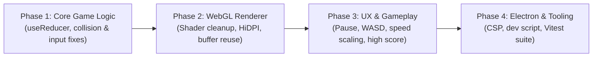

# Snake Game — Code Review & Improvement Plan

## Overview

This document provides a technical review of the `snake_game` project (Electron + React + WebGL) and outlines a prioritized, phased roadmap of improvements covering bug fixes, React state architecture, WebGL rendering, gameplay features, and Electron/developer tooling.

---

## 1. Critical Bugs & Logic Issues

### 1.1 Impure State Updater Breaks Scoring in `React.StrictMode`
- **Location:** [`src/useSnakeGame.js`](src/useSnakeGame.js#L24-L53), [`src/main.jsx`](src/main.jsx#L6-L8)
- **Issue:** Inside `setSnake((prevSnake) => { ... })`, the updater function triggers side effects (`setGameOver(true)`, `setScore((s) => s + 1)`, and `spawnFood(newSnake)`). Because the app runs in `<React.StrictMode>`, React intentionally invokes state updaters twice in development to detect side effects. This causes:
  - The score to increment by **2** instead of **1** whenever food is eaten in development.
  - `spawnFood` to execute twice per food consumption.
- **Fix:** Refactor `useSnakeGame` to manage `{ snake, food, direction, score, gameOver, status }` in a single pure `useReducer` (where a `TICK` action computes the next state deterministically without nested `setState` calls).

### 1.2 Rapid Keypress 180° Self-Collision Bug
- **Location:** [`src/useSnakeGame.js`](src/useSnakeGame.js#L78-L84)
- **Issue:** `handleSetDirection` validates the requested direction against `prevDir` (the pending state) rather than the direction the snake actually moved during the *last game tick*. If the snake is moving right (`{ x: 1, y: 0 }`) and the player presses `ArrowUp` followed by `ArrowLeft` within the same 150ms interval, `direction` becomes `{ x: -1, y: 0 }` before `moveSnake` runs—causing the snake to immediately reverse into itself.
- **Fix:** Track `lastMovedDirection` in the game state (or maintain a bounded 2-input queue per tick) and validate new direction changes against the last committed movement direction.

### 1.3 False-Positive Tail Collision
- **Location:** [`src/useSnakeGame.js`](src/useSnakeGame.js#L36-L50)
- **Issue:** Self-collision is checked against all of `prevSnake` *before* the tail segment is popped (`newSnake.pop()`). When the head moves into the exact cell that the tail is vacating on the same tick (and no food is at that cell), the game falsely registers a self-collision.
- **Fix:** Exclude the final tail segment from the collision check when the snake is not growing on that tick.

### 1.4 Unbounded `while (true)` Loop in `spawnFood`
- **Location:** [`src/useSnakeGame.js`](src/useSnakeGame.js#L56-L70)
- **Issue:** `spawnFood` repeatedly samples random `(x, y)` coordinates until it finds an unoccupied cell. As the snake grows, random rejection sampling degrades, and if the snake fills all 400 cells, the `while (true)` loop freezes the renderer process indefinitely.
- **Fix:** Compute the list of unoccupied grid cells and pick one at random in $O(N)$ time. If no unoccupied cells remain, transition the game to a `won` state.

### 1.5 Interval Reset on Every Food Consumption
- **Location:** [`src/useSnakeGame.js`](src/useSnakeGame.js#L54-L75)
- **Issue:** `moveSnake` lists `food` in its `useCallback` dependency array, and the `setInterval` `useEffect` depends on `moveSnake`. Every time food is eaten, the interval is torn down and recreated, resetting the tick cadence. Additionally, the interval remains active even when `gameOver` is `true`.
- **Fix:** With `useReducer`, `dispatch({ type: 'TICK' })` has a stable identity, so the timer only restarts when the game status (`running` / `paused` / `gameOver`) or tick speed changes.

---

## 2. WebGL Rendering Improvements

### 2.1 Shader Lifecycle & Error Handling
- **Location:** [`src/WebGLCanvas.jsx`](src/WebGLCanvas.jsx#L37-L65), [`src/WebGLCanvas.jsx`](src/WebGLCanvas.jsx#L104-L113)
- **Issues:**
  - If `loadShader` returns `null`, `initShaderProgram` still calls `gl.attachShader` with `null` and leaks any shader that did compile.
  - `vertexShader` and `fragmentShader` are never deleted (`gl.deleteShader`) during cleanup.
  - WebGL initialization failure calls blocking `alert(...)` instead of rendering a fallback UI in React.
  - Missing `webglcontextlost` and `webglcontextrestored` event handlers.
- **Fix:** Guard shader compilation before attaching, delete individual shaders after linking (or on cleanup), handle context loss events, and expose an error state to render a clean UI fallback.

### 2.2 Reduce Per-Tick Allocations & Add Visual Polish
- **Location:** [`src/WebGLCanvas.jsx`](src/WebGLCanvas.jsx#L116-L187)
- **Issues:**
  - On every render tick, new JavaScript arrays (`positions`, `colors`) and new `Float32Array` instances are allocated and uploaded, and vertex attribute pointers are re-bound.
  - Canvas dimensions do not account for `window.devicePixelRatio`, resulting in soft edges on HiDPI displays.
  - Board and config constants (`GRID_SIZE = 20`, `CANVAS_SIZE = 400`) are duplicated across [`src/useSnakeGame.js`](src/useSnakeGame.js#L3-L5) and [`src/App.jsx`](src/App.jsx#L40).
- **Fixes:**
  - Share board configuration constants from a single module (`src/constants.js`).
  - Scale the canvas backing store by `window.devicePixelRatio`.
  - Pre-allocate a reusable `Float32Array` buffer sized to the maximum cell count (`CELL_COUNT * CELL_COUNT * 6`).
  - Render subtle background grid lines in WebGL to improve spatial visibility.

---

## 3. Gameplay & UX Enhancements

- **Location:** [`src/App.jsx`](src/App.jsx#L8-L59), [`index.html`](index.html#L1-L34)
- **Planned Improvements:**
  1. **Expanded Controls:** Support `WASD` keys alongside Arrow keys, prevent default browser scrolling on Arrow/Space keys (`e.preventDefault()`), and add `Space` / `P` to pause and resume.
  2. **Game States & Overlays:** Add Start, Paused, Game Over, and Victory overlays with interactive buttons in addition to keyboard shortcuts.
  3. **Progressive Speed & High Score:** Gradually decrease the tick interval as the score increases (with a minimum floor) and persist the all-time high score in `localStorage`.
  4. **Code Cleanup:** Remove unused imports (`useState`, `useRef`, `direction`) in [`src/App.jsx`](src/App.jsx#L1-L6) and remove the broken `/vite.svg` favicon reference in [`index.html`](index.html#L5).

---

## 4. Electron & Developer Tooling

- **Location:** [`electron/main.js`](electron/main.js#L8-L29), [`package.json`](package.json#L6-L12)
- **Planned Improvements:**
  1. **Detached DevTools in Development:** Open DevTools with `{ mode: 'detach' }` in [`electron/main.js`](electron/main.js#L22) so the `800x600` window is not cramped around the `400x400` canvas.
  2. **Content Security Policy (CSP):** Add a strict `<meta http-equiv="Content-Security-Policy" ...>` policy in [`index.html`](index.html) and moves inline styles to a dedicated stylesheet (`src/styles.css`).
  3. **Single-Command Dev Script:** Add `concurrently` and `wait-on` so `npm run dev:electron` starts Vite and launches Electron automatically once `http://localhost:5173` is listening.
  4. **Unit Testing:** Add `vitest` and unit tests for the pure game reducer (movement, eating food, self-collision, tail-vacating edge case, 180° rapid turn prevention, and win condition).

---

## 5. Implementation Roadmap

| Phase | Scope | Target Files | Priority |
| :--- | :--- | :--- | :--- |
| **Phase 1** | Pure `useReducer` state machine, input queue / `lastMovedDirection`, tail collision fix, $O(N)$ `spawnFood` & win condition | `src/useSnakeGame.js`, `src/constants.js` | High |
| **Phase 2** | WebGL shader/buffer cleanup, context loss handling, HiDPI scaling, reusable typed arrays, background grid | `src/WebGLCanvas.jsx` | High |
| **Phase 3** | Pause/Resume, WASD controls, high score persistence, progressive speed scaling, external CSS | `src/App.jsx`, `src/styles.css`, `index.html` | Medium |
| **Phase 4** | Detached DevTools, CSP header, unified dev script, Vitest unit tests for game reducer | `electron/main.js`, `package.json`, `src/__tests__/` | Medium |
